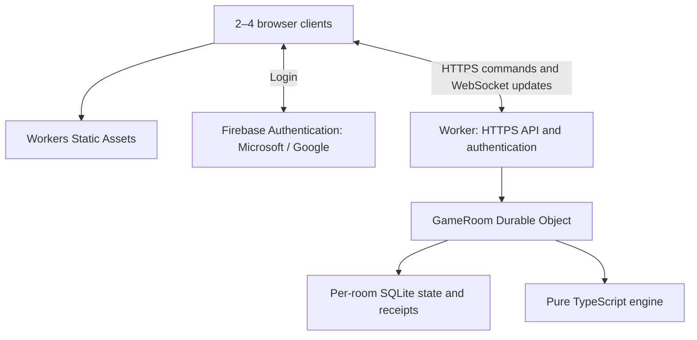

# Architecture

## Decision

One Cloudflare Worker serves the static SPA and `/api/*`. Each opaque room ID routes to exactly one SQLite-backed `GameRoom` Durable Object via `idFromName`. The object owns membership, lobby, game state, accepted command receipts, events and temporary socket tickets. Firebase Authentication supplies user identity only. No global room database in MVP; browser recent links are convenience, not authorization.

## Boundary responsibilities

Browser: render public state, obtain Firebase ID tokens, submit commands with UUID IDs and versions, handle rejection/reconnect. It may preview legal actions but never decides authoritative outcomes. Use relative `/api` routes on the same origin. Do not optimistically consume cards or actions.

Worker: route only supported paths; enforce body limits and allowed origins, verify JWT signature/issuer/audience/expiry using Google Secure Token public certificates and pinned Firebase project claims, derive stable opaque Firebase UID and sanitized display name, route to the named object. Never trust a caller-provided identity header; construct internal identity arguments after verification. Set no-store for authenticated API responses.

GameRoom: authorize membership, validate schema, serialize mutations with storage transactions, call engine, persist before reply, broadcast public snapshots. Durable Objects provide a per-room coordinator but do not excuse races across async boundaries. No network awaits between state read and commit.

Engine: `createGame(config, seed)`, `applyCommand(state, actorId, command)`, `legalActions(state, actorId)`, `projectPublicState(state)`. Inputs immutable; return either a validation error or next state+ordered semantic events. State holds RNG state; wall-clock timestamps are assigned by the orchestration layer, not used in rules.

## Mutation algorithm

1. Verify token/schema outside room transaction; pass trusted identity to room.
2. In a synchronous SQLite transaction, check room active/membership, then receipt by `(userId, commandId)`.
3. If receipt exists and canonical command payload/hash matches, return recorded result without re-execution. A reused ID with different payload returns COMMAND_ID_REUSED. Check receipt before expectedVersion so retries work after later moves.
4. If new command, verify expectedVersion against stored room revision; validate phase/actor/legality.
5. Calculate candidate next state without mutating a shared cache. Automatic draw/infection resolution is part of this candidate until the next interactive/terminal phase.
6. Store state, increment revision once per accepted command, insert all events and receipt in the same transaction. Lobby mutation revisions also count. Invalid commands write nothing and do not change version.
7. After commit, update any in-memory cache, acknowledge and broadcast. Broadcast failure never rolls back an accepted command. A client can retry/read the snapshot.

Use `storage.transactionSync` for SQL work with parameterized statements. Validate SQLite constraints and fault injection tests in the Cloudflare runtime. Awaiting another service during mutation is prohibited. Avoid a write-through cache in the first implementation: reading the small current snapshot in each transaction is simpler.

## Realtime choice

All commands travel through authenticated HTTPS POST, not WebSocket frames. WebSockets push snapshots/presence only. This avoids expiry-sensitive mutation auth in sockets and simplifies request/retry testing.

POST `/ws-ticket` requires a valid JWT and membership; stores a hash of a cryptographically random, single-use 60-second ticket in the room. The upgrade consumes it atomically. Bind ticket to room, user, expected origin, and access-token expiry. Never use a permanent JWT or invitation secret as the WebSocket credential. Redact ticket query strings in observability.

Use `ctx.acceptWebSocket`, WebSocket attachments, `ctx.getWebSockets()` and event handlers. Attach userId and authExpiresAt. On every outgoing broadcast, verify current membership/expiry and close expired sockets. A scheduled room alarm closes idle expired sockets at the earliest expiry; multiplex this with retention, not one perpetual timer per connection. Use protocol ping or auto-response support instead of JS interval heartbeats. Constructor/hibernation recovery must restore state and connection metadata without resetting the game.

On connect/reconnect send a current public snapshot. Clients ignore older versions; same-version retry acknowledgments do not regress display. On a missed update, refresh snapshot. Backpressure: cap two sockets/user and eight/room; replace oldest same-user connection when necessary. Slow socket sends are best-effort; close and reconnect instead of buffering unlimited snapshots.

## Room lifecycle

Create uses a client-generated cryptographically random UUID as an idempotency/routing key; first claimant is owner. Server-generated invites carry separate 128-bit random secrets. A competing creator for the same ID cannot overwrite it. Only explicitly authorized create initializes an object; reads/joins to nonexistent rooms return 404 and never create a logical room.

Join requires auth and valid invite secret, and has an atomic max-four check. Existing member rejoin is idempotent. Invite rotation invalidates old invitations. Started games lock membership. Empty lobby is marked abandoned; disconnect alone is not leave. Terminal games retained 30 days; lobbies expire after 7 days without accepted mutation; running games after 30 days without accepted gameplay mutation. Read/socket activity does not extend retention.

Cleanup alarm removes state, tickets and receipts and leaves a small expired tombstone for 30 additional days; after final deletion old links may return 404. No indefinite host lease and no global singleton coordinating unrelated rooms.

## Deployment constraints

One Worker plus its bindings per environment; separate preview and production object namespaces and auth projects preferred. Static assets are public; API responses contain private room data and are never edge-cached. `run_worker_first` targets `/api/*`, keeping normal asset requests out of Worker compute. SPA fallback must never turn API errors into index.html.

Cloudflare room storage is the canonical save. Firebase Authentication outage blocks fresh login but does not justify accepting unverified tokens. Existing valid Firebase ID tokens can be checked with cached signing keys until expiry; unknown key IDs fail closed after a bounded refresh attempt. In MVP, logout clears the client and closes its sockets; previously issued ID tokens remain valid until expiry unless explicitly revoked server-side. Document this bounded JWT-session behavior.

## Firebase identity boundary

The client uses Firebase Web SDK popup login and sends a Firebase ID token to the Worker. The Worker verifies RS256 signature and Google Secure Token certificates, with issuer `https://securetoken.google.com/<projectId>` and audience exactly FIREBASE_PROJECT_ID. `sub` is an opaque Firebase UID, not a UUID. See AUTH.md for mandatory claims, cache/rotation behavior, revocation limitations and popup handling. No Firebase Admin SDK, service account or Firebase database is needed in the deployed Worker. Authenticate before dispatching to a room; never turn provider downtime into an auth bypass.
